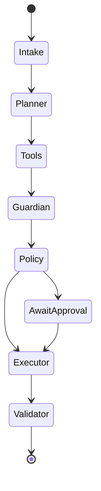

# Setu 桥 — TypeScript backend (as built)

**Setu 桥 is a guarded agent for cross-border student finance.** All data is **SYNTHETIC**, the bank is a **SANDBOX**, FX defaults to labelled SAMPLE rates, and Setu never holds funds. The backend lives in `server/` and is the only backend; the web front end (`web/`) talks to it over the HTTP contract in `docs/API.md`.

## At a glance

- **Layout:** single package `server/` (no monorepo). ESM, Node 20, TypeScript strict, Fastify 5, Zod, Vitest (+ fast-check).
- **DB:** raw `better-sqlite3@12.4.1` with typed row mappers (no ORM); money stored as TEXT decimal strings; timestamps TEXT `YYYY-MM-DDTHH:MM:SS.ffffffZ`. The version is pinned because newer releases need Node 22+ prebuilds.
- **TOTP:** hand-written RFC 6238 on `node:crypto` (injectable clock, ±1 step, replay protection, 5-failure/300 s lockout), checked against recorded reference vectors.
- **Agents:** intake → planner → tools → guardian → policy → executor / await-approval → validator, a plain state machine (no agent framework). Guardian and intake regexes use Unicode-aware stand-ins for `\w`/`\b`/`\d` (JS built-ins are ASCII-only); 555 recorded guardian/intake vectors and 290 `policy.decide` vectors pin behaviour; the audit chain and AES-GCM envelope have pinned cross-implementation vectors.
- **LLM:** interface + deterministic scripted planner only. Network adapters are not wired (any `LLM_PROVIDER` resolves to scripted), so the demo is fully offline.
- **Documents:** text upload/paste only; PDF upload returns 422 `UNSUPPORTED_DOCUMENT`. No refresh tokens. `docs/API.md` is hand-maintained.
- **Contract checks:** `tests/parity/demo_replay.test.ts` replays a recorded reference demo transcript (shape-parity, not byte-parity). `server/scripts/contract_diff.ts` (`make contract`) runs 29 requests against two running backends (BASELINE vs CANDIDATE, fresh DBs) and compares status + JSON shape. Unknown routes return a plain `{"detail":"Not Found"}` (not the error envelope); `web/lib/api.ts` tolerates it.
- **Secure defaults:** `DEMO_MODE` defaults to **false** (`/demo/*` is 404 unless `DEMO_MODE=true` or a valid `X-Admin-Token`); fresh random 12-byte AES-GCM IV per encryption; `timingSafeEqual` for secret comparisons; dev default keys rejected outside dev; audit `head_hash` printed at seed and demo end.
- **Seed data:** `server/scripts/generate_data.ts` (`make seed-data` / `npm run seed-data`) deterministically regenerates everything in `data/`; re-running leaves `git diff data/` empty.
- **Run:** `cd server && npm ci && npm test && npm run demo && npm run evidence`; API: `DEMO_MODE=true npm start` (port 8000).

## Directory tree

```
server/
├── src/
│   ├── main.ts, app.ts       # Fastify bootstrap, security headers, CORS, error handler, route registration
│   ├── config.ts             # env schema (zod), derived settings
│   ├── deps.ts               # auth, roles, TOTP verification, rate limiting
│   ├── security.ts           # argon2id, JWT (HS256 pinned), RFC 6238 TOTP
│   ├── db/                   # connection.ts, schema.ts, auditStore.ts (atomic hash-chained append + verify)
│   ├── domain/               # pure functions: fx, costs, budget, policy, audit, crypto, tokenize, money, keys
│   ├── agents/               # graph, intake, planner, tools, guardian, executor, llmAdapters, replyValidator, replies
│   ├── sandboxBank/          # ledger.ts: open account, idempotent transfer, deterministic failures
│   ├── routes/               # auth, documents, chat, actions, payees, fx, audit, evidence, dashboard, sandbox, demo
│   ├── actionsService.ts, docService.ts, services.ts   # orchestration glue
│   ├── evalkit/              # golden tasks, notice corpus, 17 attacks, in-memory eval world
│   ├── seed.ts, demo.ts, evidence.ts
├── eval/tasks.yaml           # 25 golden tasks (G01–G25)
├── scripts/                  # generate_data.ts (seed data), contract_diff.ts (live A/B shape diff)
└── tests/                    # unit/, api/, golden/, security/, parity/, fixtures/ (vitest)
```

## Invariant contract

| Aspect | Rule |
|--------|------|
| **HTTP paths** | `/auth/*`, `/chat`, `/documents`, `/actions/*`, `/payees`, `/fx/*`, `/audit`, `/evidence/export`, `/dashboard`, `/sandbox/*`, `/demo/*`. |
| **JSON keys** | snake_case; money fields always `_cny`; see API.md for exact shapes. |
| **Money** | Always JSON strings with two decimals (e.g. `"18500.00"`), computed with `decimal.js` from strings, never floats; ROUND_HALF_EVEN where quantized. |
| **Policy tiers** | T0–T4; outcomes `ALLOW` / `REQUIRE_APPROVAL` / `REQUIRE_COOLING_OFF` / `BLOCK`. |
| **Audit chain** | SHA-256 hash chain over canonical JSON (keys sorted by code point, compact separators, non-ASCII raw, floats rejected); payload redacted before hashing. |
| **Error envelope** | `{ error: { code, message, details }, request_id }`; 401/403/404/409/413/422/429. 422 uses `validation_error` with `details: {errors:[{loc, msg}]}`. Foreign resources are 404, never 403. |
| **Sandbox ledger** | Destination ending `0013` → `ACCOUNT_CLOSED`; amount > CNY 50k → `LIMIT_EXCEEDED`; cents `.99` → `RISK_HOLD`; balance < amount → `INSUFFICIENT_FUNDS`; same idempotency key + same params returns the original transaction, different params is rejected. |
| **Evidence harness** | Golden tasks G01–G25 and attacks A01–A17 run against the real app; reports in `evidence/`. |

## Agent flow



| Step | Responsibility | Trust boundary |
|------|---------------|----------------|
| **Intake** | Text extraction, regex field parsing, `<untrusted>` wrapper, account tokenisation | Input is untrusted |
| **Planner** | Intent classification, allowlisted `ToolCall[]` | Model output validated against Zod schemas |
| **Tools** | Deterministic functions (get_obligation, fx_quote, compute_costs, budget_summary, propose_*) | Only source of numbers |
| **Guardian** | Injection phrases, personal accounts, urgency scams, homoglyphs, lookalike payees, amount mismatches, registry checks | Rule coverage is finite |
| **Policy** | Single authority: `decide(action, ctx)` → tier/outcome | Core safety gate |
| **Executor** | Executes only `ALLOW`; otherwise awaits approval | Sandbox ledger only |
| **Validator** | Every number in the reply must appear in tool outputs | Output integrity |

### Policy tiers

| Tier | Meaning | Required approvals |
|------|---------|--------------------|
| **T0** | Read-only (quotes, explanations) | None |
| **T1** | Drafts (nothing sent) | None |
| **T2** | Payment ≤ CNY 2,000 to a verified payee, within the 24 h rolling cap | Student TOTP |
| **T3** | Payment > CNY 2,000, over cap, or new/changed payee | Student TOTP + family approver TOTP (+ 24 h cooling-off for new/changed payees) |
| **T4** | Blocked: unverified payee, document/SMS/model-only source, guardian block, cross-user payee, amount mismatch, bulk export | — |

## Node/TypeScript-specific risks

| Risk | Mitigation |
|------|------------|
| Prototype pollution from untrusted JSON | Zod parsing of every request body; no `Object.assign` of user data onto shared objects |
| `JSON.parse` of model output | Always re-validated with Zod; values never trusted blindly |
| ReDoS in guardian regexes | Explicit, bounded patterns; worst-case inputs in `tests/security/redos.test.ts` |
| IEEE 754 doubles | Money is never a JS number; `decimal.js` everywhere; canonical JSON rejects floats |
| Event-loop concurrency | Atomic SQLite transactions for audit append and ledger transfers; in-memory rate limiter |
| Supply chain | `package-lock.json` pinned, `npm ci` in CI and Docker; gitleaks secret scan in CI |
| Timing attacks | `timingSafeEqual` for HMAC/tokens/TOTP; argon2id verify is constant-time |

## Honest limitations

- No live LLM adapters (scripted planner only); no OCR/PDF parsing.
- Consent UX for approver linking is minimal (see `SECURITY_SELF_ASSESSMENT.md`).
- AES/HMAC/JWT secrets are static (no KMS or rotation); `head_hash` is not yet anchored externally.
- Rate limiter is single-process in-memory; SQLite has no migration/backup tooling yet.
- TLS is expected to be terminated by a proxy; `X-Forwarded-For` must be configured correctly.
