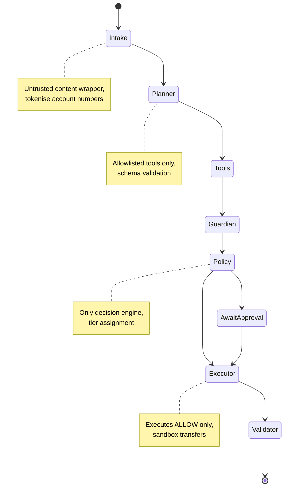

# Setu TS backend — AS BUILT (read this first; the plan below is the pre-build design)

Deviations from the plan below, all deliberate (GLM architecture review + time):
- **Layout:** single package `server/` (no `packages/shared`, no monorepo). ESM, Node 20, TypeScript strict, Vitest.
- **DB:** raw `better-sqlite3@12.4.1` with typed row mappers (no Drizzle); money stored as TEXT; timestamps TEXT in the Python format.
- **TOTP:** hand-written RFC 6238 on `node:crypto` (injectable clock, ±1 step, replay protection, 5-failure/300 s lockout) instead of `otplib`; verified against `pyotp` vectors.
- **Agents:** intake/guardian/planner/replies/policy/executor/graph hand-ported line-by-line. Guardian rule regexes are verbatim, with Unicode-aware stand-ins for Python's `\w`/`\b`; 555 differential vectors generated from the real Python code pass. `policy.decide` has 290 Python-generated vectors; audit chain and AES-GCM envelope have pinned cross-language vectors.
- **LLM:** interface + deterministic scripted planner only. Gemini/Groq network adapters were **not** ported (any `LLM_PROVIDER` resolves to scripted).
- **PDF:** not supported (text upload/paste only; PDF upload returns 422 UNSUPPORTED_DOCUMENT). No refresh tokens. No `gen_api_md` (docs/API.md is hand-maintained).
- **Parity:** shape-parity, not byte-parity. `server/scripts/contract_diff.ts` runs 29 requests against both backends on fresh DBs and compares status + JSON shape (29/29 identical). `tests/parity/demo_replay.test.ts` replays the Python demo transcript. One intentional visible difference: unknown routes return FastAPI-style `{"detail":"Not Found"}` exactly like Python.
- **Security defaults changed vs Python:** `DEMO_MODE` defaults to **false** (`/demo/*` is 404 unless `DEMO_MODE=true` or a valid `X-Admin-Token`); fresh random 12-byte AES-GCM IV per encryption; `timingSafeEqual` for secret comparisons; dev default keys rejected outside dev; audit `head_hash` printed at seed and demo end.
- **Run:** `cd server && npm ci && npm test && npm run demo && npm run evidence`; API: `DEMO_MODE=true npm start` (port 8000).

---

# Setu 桥 — TypeScript Backend Architecture (v1)

**Setu 桥 is a guarded agent for cross-border student finance.** All data is **SYNTHETIC**, the bank is a **SANDBOX**, FX defaults to labelled SAMPLE rates, and Setu never holds funds.

This document describes the architecture of the TypeScript rewrite of the Python FastAPI backend (`/workspace/setu/backend`). The web frontend (`/workspace/setu/web`) remains untouched and communicates via an identical HTTP contract.

---

## 1. Goals / Non-Goals / What Stays Identical

### Why TypeScript?

- **Single-language stack**: Frontend and backend share one language with first-class IDE support, native tooling, and growing ecosystem for enterprise-grade applications.
- **Web-ready**: TypeScript is naturally suited for full-stack Node.js deployment in cloud/container environments; many teams already operate JS/TS infra.
- **Tooling maturity**: Zod schemas provide runtime + compile-time validation, mirroring the Python Pydantic v2 approach used today; Fastify offers comparable performance to FastAPI.
- **Ecosystem parity**: Libraries exist for JWT, argon2 hashing, TOTP, encryption, SQLite access, decimal arithmetic, logging, testing, and LLM adapters.

### Goals

- Byte-compatible API contract: same paths, request/response shapes, error format, status codes.
- Deterministic offline mode by default (scripted planner adapter, SAMPLE FX fixture).
- Preserve policy tiers T0–T4, guardian rules, hash-chained audit chain, sandbox ledger invariants.
- Same seed data, synthetic personas, demo scenarios, eval tasks (25+), attack corpus (17).
- Reproducible demos/tests without external keys or network access.

### Non-Goals

- Real payment rail integration (always sandbox).
- OCR support (only text-layer PDFs / plain text).
- Docker or makefile tooling on the dev box (untested here; provided as optional deployment assets).
- Mobile wrappers (separate phase later; PWA/Capacitor pattern documented but not implemented).

### What Stays Identical (invariant contract)

| Aspect | Identity |
|--------|----------|
| **HTTP paths** | `/auth/*`, `/chat`, `/documents`, `/actions/*`, `/payees`, `/fx/*`, `/audit`, `/evidence/export`, `/dashboard`, `/sandbox/*`, `/demo/*` unchanged. |
| **JSON keys** | Field names preserved exactly (snake_case for some legacy IDs like `action_id`, but money fields always `_cny`; see API.md for exact shapes). |
| **Money representation** | Always JSON strings with two decimals (e.g., `"18500.00"`). No floats. |
| **Policy tiers** | T0=T3 logic preserved; decision outcomes: `ALLOW` / `REQUIRE_APPROVAL` / `REQUIRE_COOLING_OFF` / `BLOCK`. |
| **Audit chain format** | SHA-256 hash-chain with identical canonical JSON serialization; payload redacted before hashing. |
| **Error envelope** | `{ error: { code, message, details }, request_id }` shape; HTTP 401/403/404/409/429/413/422 codes preserved. |
| **Sandbox ledger rules** | Destination ending `0013`→ACCOUNT_CLOSED; amount >CNY 50k→LIMIT_EXCEEDED; cents `.99`→RISK_HOLD; idempotency semantics unchanged. |
| **Evidence harness** | Same tasks YAML ids (G01–G25); attacks A01–A17 run against endpoints; reports diffed to ensure parity. |

---

## 2. Monorepo Layout & Directory Tree

```
setu/
├── package.json              # root workspace definition
├── server/                   # TypeScript backend (replaces backend/)
│   ├── src/
│   │   ├── main.ts           # Fastify bootstrap, middleware, CORS, health
│   │   ├── config.ts         # env schema (zod), derived settings
│   │   ├── deps.ts           # DI-like resolution for services/db/cache
│   │   ├── db/               # Drizzle schema, migrations, bootstrap
│   │   │   ├── schema.ts     # tables: users, payees, documents, obligations, plans, actions, audit, sbx_accounts, sbx_txns
│   │   │   └── index.ts      # sqlite connection, pool
│   │   ├── domain/           # Pure functions (no framework glue)
│   │   │   ├── fx.ts         # FX quotes, fixture/live switch, cache, clock injection
│   │   │   ├── costs.ts      # fee model (fixed + % margin), sandbox channel params
│   │   │   ├── budget.ts     # summaries, monthly spent vs cap
│   │   │   ├── policy.ts     # decide(action, ctx) → Tier/outcome/reasons
│   │   │   ├── audit.ts      # canonical JSON, hash-chain compute/verify
│   │   │   ├── crypto.ts     # AES-256-GCM with AAD (enc:v1:), HMAC-SHA256
│   │   │   └── tokenize.ts   # NFKC normalisation, homoglyph detection, tokenization/redaction
│   │   ├── agents/           # Agent graph, no orchestration frameworks
│   │   │   ├── graph.ts      # intake→planner→tools→guardian→policy→executor/ap...→validator pipeline
│   │   │   ├── intake.ts     # text/PDF extraction, regex field parsing, tokenise accounts, <untrusted> wrapper
│   │   │   ├── planner.ts    # ScriptedAdapter classification, allowlisted tool calls, schema validation
│   │   │   ├── tools.ts      # deterministic functions: get_obligation, list_obligations_due, fx_quote, compute_costs, budget_summary, propose_payment, propose_verify_payee, draft_message
│   │   │   ├── guardian.ts   # rule-based scanner: injection phrases, personal accounts, urgency scams, homoglyphs, lookalikes, amount mismatch, registry checks
│   │   │   ├── executor.ts   # execute ONLY ALLOW actions; sandbox transfer, awaiting_approval state machine
│   │   │   ├── llmAdapters.ts # Gemini/Groq adapters; tokenised text only; fallback to scripted
│   │   │   ├── replyValidator.ts # validate every number in reply is grounded in tool outputs
│   │   │   └── replies.ts    # natural language templates EN/ZH
│   │   ├── sandbox_bank/     # Toy ledger, synthetic only
│   │   │   ├── ledger.ts     # open_account, transfer (idempotent, deterministic failures), list_transactions
│   │   │   └── api.ts        # endpoints: GET /account, GET /transactions
│   │   ├── routes/           # Fastify handlers (request → service → response)
│   │   │   ├── auth.ts       # register, login, logout, refresh, me
│   │   │   ├── totp.ts       # setup, verify, enable/disable
│   │   │   ├── documents.ts  # upload, confirm, list, delete
│   │   │   ├── chat.ts       # POST /chat: orchestrate agent graph, return trace
│   │   │   ├── actions.ts    # list, approve, reject
│   │   │   ├── payees.ts     # list, create, verify
│   │   │   ├── fx.ts         # quote (params validated, result labelled)
│   │   │   ├── audit.ts      # list, verify=true returns chain check
│   │   │   ├── evidence.ts   # export: redacted audit rows + head_hash
│   │   │   ├── dashboard.ts  # summary with obligations, pending actions, FX disclaimer
│   │   │   └── demo.ts       # demo-only: reset, personas, totpeeker, tamper-helpers
│   │   ├── services/         # orchestration glue (NOT pure functions)
│   │   │   ├── docService.ts # parse text, guardian scan, obligation creation
│   │   │   ├── actionService.ts # approve/reject transitions, cooling-off enforcement
│   │   │   ├── chatService.ts # invoke graph, build trace, validator wrap
│   │   │   └── evidenceService.ts # export scope, admin check
│   │   ├── tests/            # vitest configs (see Section 5)
│   │   │   ├── unit/         # domain, agents (pure funcs), ledger
│   │   │   ├── api/          # fastify.inject() endpoint tests (auth flow, CRUD)
│   │   │   ├── golden/       # 25+ tasks from tasks.yaml
│   │   │   └── security/     # 17 attacks
│   │   ├── seed.ts           # populate synthetic users, obligations, documents
│   │   ├── demo.ts           # scripted demo sequence
│   │   └── scripts/          # gen_api_md.ts, evidence runner
│   ├── test/                 # test utils, fixtures, factories
│   └── package.json          # dependencies: fastify, @fastify/*, zod, drizzle-orm, better-sqlite3@12.4.1, @node-rs/argon2, otplib, jose, decimal.js, pino, vitest, @vitest/runner, fast-check, pdf-parse/prebuild-install
├── packages/
│   └── shared/               # Common TS types/schemas reusable by server/web
│       ├── zod/              # request/response schemas (inferred types also exported)
│       ├── types/            # API contract types: ActionOut, Decision, Trace, Plan, etc.
│       └── package.json
├── web/                      # Next.js frontend (EN / 简体中文) — UNTOUCHED
│   ├── src/
│   ├── package.json
│   └── ...
├── docs/                     # Architecture/API/security docs
│   ├── ARCHITECTURE_TS.md    # this file
│   ├── ARCHITECTURE.md       # original Python architecture
│   ├── DATA_FLOW.md
│   ├── THREAT_MODEL.md
│   ├── SECURITY_SELF_ASSESSMENT.md
│   ├── API.md                # live API examples captured from running app
│   └── evidence/             # reports from real runs (eval_report, security_report, sandbox_logs.jsonl)
├── data/                     # Fixed fixtures (FX sample rates, channel_costs.csv)
├── backend/                  # Original Python source (read-only reference)
│   ├── app/
│   │   ├── domain/
│   │   ├── agents/
│   │   ├── sandbox_bank/
│   │   ├── routes/
│   │   ├── models.py, db.py, security.py, seed.py, demo.py, etc.
│   ├── eval/
│   │   ├── tasks.yaml (25+ golden tasks)
│   │   ├── attacks.py (17 attack scenarios)
│   │   ├── run_eval.py, run_security.py
│   │   └── world.py
│   └── tests/
│       ├── unit/, api/, golden/, security/
├── scripts/                  # Bash helper scripts (if any)
├── Makefile / docker-compose.yml (optional; untested in dev box)
├── .env.example
└── README.md
```

### Python Module → TypeScript Counterpart Mapping

| Python (`backend/app`) | TypeScript (`server/src`) | Notes |
|------------------------|---------------------------|-------|
| `domain/crypto.py` | `domain/crypto.ts` | AES-256-GCM, AAD `totp:{userId}` / `payee:{id}` |
| `domain/tokenize.py` | `domain/tokenize.ts` | NFKC, homoglyphs, redactPII |
| `domain/audit.py` | `domain/audit.ts` | Canonical JSON, hash-chain compute/verify |
| `domain/fx.py` | `domain/fx.ts` | FX fixture/live switch, caching |
| `domain/costs.py` | `domain/costs.ts` | Fee model computation |
| `domain/budget.py` | `domain/budget.ts` | Budget summaries |
| `domain/policy.py` | `domain/policy.ts` | `decide()` function (core authority) |
| `agents/graph.py` | `agents/graph.ts` | State machine pipeline |
| `agents/intake.py` | `agents/intake.ts` | PDF/text parsing, field extraction |
| `agents/planner.py` | `agents/planner.ts` | Intent classification, tool calls |
| `agents/tools.py` | `agents/tools.ts` | Tool implementations |
| `agents/guardian.py` | `agents/guardian.ts` | Rule-based scanning |
| `agents/executor.py` | `agents/executor.ts` | Execute only ALLOW decisions |
| `agents/llm_adapters.py` | `agents/llmAdapters.ts` | Gemini/Groq adapters |
| `agents/validator.py` | `agents/replyValidator.ts` | Ground numbers in reply |
| `agents/replies.py` | `agents/replies.ts` | Text templates |
| `sandbox_bank/ledger.py` | `sandbox_bank/ledger.ts` | Ledger invariants, idempotency |
| `sandbox_bank/api.py` | `sandbox_bank/api.ts` | Sandbox endpoints |
| `routes/auth.py` | `routes/auth.ts` | Register/login/JWT |
| `routes/documents.py` | `routes/documents.ts` | Document upload/confirm/delete |
| `routes/chat.py` | `routes/chat.ts` | Chat orchestration |
| `routes/actions.py` | `routes/actions.ts` | Approve/reject actions |
| `routes/payees.py` | `routes/payees.ts` | Payee management |
| `routes/fx.py` | `routes/fx.ts` | FX quoting |
| `routes/audit.py` | `routes/audit.ts` | Audit listing & verification |
| `routes/evidence.py` | `routes/evidence.ts` | Evidence export |
| `routes/dashboard.py` | `routes/dashboard.ts` | Dashboard summary |
| `routes/demo.py` | `routes/demo.ts` | Demo endpoints (DEMO_MODE) |
| `security.py` | `deps.ts` + `domain/crypto.ts` | argon2, JWT, TOTP |
| `models.py` | `db/schema.ts` | Drizzle table definitions |
| `db.py` | `db/index.ts` | SQLite connection |
| `seed.py` | `seed.ts` | Synthetic seeding |
| `demo.py` | `demo.ts` | Demo script |
| `eval/tasks.yaml` | kept in `/backend/eval` | Read by both; TS uses copy/port |
| `eval/attacks.py` | `tests/security/*.ts` | Ported to vitest |
| `tests/unit/` | `tests/unit/` | Equivalent tests |
| `tests/api/` | `tests/api/` | Equivalent tests |
| `tests/golden/` | `tests/golden/` | Equivalent tests |
| `scripts/gen_api_md.py` | `scripts/gen_api_md.ts` | API doc generator |

---

## 3. Tech Stack & Rationale

| Component | Version | Rationale |
|-----------|---------|-----------|
| **Runtime** | Node 20.19.x LTS | Stable LTS; widely supported; matches dev box. |
| **Language** | TypeScript 5.x strict | Type-safe JS; modern syntax; great DX. |
| **Framework** | Fastify 4.x | High performance, plugin architecture, schema-first. |
| **Validation** | zod 3.x | Runtime + static type inference; stricter than Python's Extra forbid via config. |
| **ORM** | Drizzle ORM + better-sqlite3@12.4.1 | Type-safe SQL queries; better-sqlite3 synchronous binding ideal for single-writer SQLite; **PINNED at 12.4.1** because newer versions require Node 22+, and prebuilt binaries don't work on Node 20 without compiler toolchain. |
| **Auth** | jose (JWT HS256), @node-rs/argon2, otplib | Argon2id password hashing; RFC 6238 TOTP; JWT pinned algorithm. |
| **Crypto** | node:crypto (AES-256-GCM, HMAC-SHA256) | Native Node crypto library. |
| **Decimal** | decimal.js 11.x | Exact decimal arithmetic (never float); quantize modes match Python Decimal behavior. |
| **PDF** | pdf-parse or pdfjs-dist | Extract text-layer from PDFs (no OCR). |
| **Logging** | pino + redaction plugins | Structured JSON logs with PII redaction paths. |
| **Testing** | vitest + fast-check | Fast test runner; property-based testing for domain invariants. |
| **Linting** | ESLint + Prettier + tsc --noEmit | Static analysis and formatting. |

**Notes:**

- **better-sqlite3@12.4.1**: This specific version has prebuild binaries compatible with Node 20. Newer releases dropped Node 20 compatibility; without g++/node-gyp available on the dev box, we cannot compile from source. Hence the pin.
- **No npm workspaces issues**: Use `prebuild-install` quirk workaround when installing native modules on this platform.

---

## 4. Key Design Decisions & Porting Concerns

### Decimal Arithmetic (`decimal.js`)

Python's `Decimal("1234.50")` must be reproduced exactly:

- **String input only**: Never construct from float (`new Decimal(1234.5)` wrong).
- **Quantize modes**: ROUND_HALF_EVEN (bankers' rounding) used in `costs.ts` for fees.
- **Example parity**:
  - Python: `Decimal("18500") * Decimal("0.004") = Decimal("74.00")`
  - TS: `new Decimal("18500").mul("0.004") === "74.00"`

All money fields serialized as `"amount_cny": "18500.00"` strings.

### Canonical JSON Serialization (Audit Chain)

Python's `json.dumps(obj, sort_keys=True, separators=(",", ":"), ensure_ascii=False)`:

- **sort_keys**: lexicographically order object keys recursively.
- **separators**: compact JSON (no spaces).
- **ensure_ascii=False**: preserve Unicode characters.

**TypeScript equivalent** (must produce byte-identical hashes):

```typescript
// Port of json.dumps(obj, sort_keys=True, separators=(",",":"), ensure_ascii=False, default=str)
export function canonicalJSON(v: unknown): string {
  if (v === null || v === undefined) return "null";
  if (typeof v === "string") return JSON.stringify(v); // matches Python for all BMP text; lone surrogates not expected
  if (typeof v === "boolean") return v ? "true" : "false";
  if (typeof v === "number") { if (!Number.isInteger(v)) throw new Error("floats forbidden in audit payloads"); return String(v); }
  if (Array.isArray(v)) return "[" + v.map(canonicalJSON).join(",") + "]";
  if (typeof v === "object") {
    // Python sorts keys by Unicode code point; JS default sort is UTF-16 code units -> compare by code points
    const keys = Object.keys(v as object).sort(codePointCompare);
    return "{" + keys.map((k) => JSON.stringify(k) + ":" + canonicalJSON((v as Record<string, unknown>)[k])).join(",") + "}";
  }
  return JSON.stringify(String(v)); // default=str fallback
}
```
Review notes (lead): (1) the first draft's `reduce` version was buggy and has been replaced; (2) payloads must never contain floats (money is decimal strings) because Python prints `1.0` and JS prints `1`; (3) Python `json.dumps` with ensure_ascii=False emits control chars as `\u00XX` and does NOT escape U+2028/2029 or `/` — same as JS `JSON.stringify`; a property test against fixed Python-generated hashes pins this.

Then encode UTF-8 bytes explicitly before SHA-256 hashing. Test each payload against Python reference hashes.

### HMAC/AES Formats

- **Encryption**: `enc:v1:<base64(ciphertext)>` prefix with AAD: `totp:{userId}`, `payee:{payeeId}`, `doc:{docId}`.
- **HMAC-SHA256**: Account lookup key: `HMAC(account_number_bytes, hmac_key)[:16]`.

Verify ciphertext length and AAD format match Python implementation.

### Argon2 Hashing

- Python: `argon2-cffi` default parameters (`memory_cost=65536, time_cost=3, parallelism=2`).
- TypeScript: `@node-rs/argon2` needs matching params. Use:
  ```typescript
  const hash = await argon2.hash(password, {
    memoryCost: 65536,
    timeCost: 3,
    parallelism: 2
  });
  ```
- Verify existing Python hashes still pass `argon2.verify`.

### TOTP Parameters

- RFC 6238, 30-second step, 6 digits.
- ±1 step tolerance (±30 seconds).
- Replay protection: track last-step via `users.last_totp_step_enc`.

### JWT Claims

- **Algorithm**: HS256 **pinned**; reject `alg=none` / RS*.
- **Claims**: `sub` (user ID), `role`, `iat`, `exp`, `jti`.
- **Expiration**: default 1 hour (`jwt_ttl_seconds` env).
- **Role re-check**: Every route reads role from DB even if JWT claims differ.

### Error Envelope

FastAPI returns:

```json
{"error": {"code": "TOTP_INVALID", "message": "...", "details": {}}, "request_id": "..."}
```

TypeScript error handler must match exactly. HTTP codes:

- 401: UNAUTHORIZED
- 403: FORBIDDEN, POLICY_BLOCKED
- 404: NOT_FOUND (never 403 for foreign resources)
- 409: ALREADY_APPROVED, COOLING_OFF_ACTIVE, EMAIL_EXISTS
- 422: `validation_error` (lowercase, as in Python; `details: {errors:[{loc:[...strings], msg}]}`); unknown HTTPException status codes map to `http_<status>`
- 429: RATE_LIMITED
- 413: TOO_LARGE

### Validation Errors (422)

FastAPI/Pydantic returns array of errors; Fastify/Zod returns simpler array too:

```json
{
  "error": {
    "code": "validation_error",
    "message": "Validation failed",
    "details": [{ path: ["email"], message: "Required" }]
  }
}
```

Keep similar shape; adjust only if needed for consistency.

### CORS

Allow `http://localhost:3000` only. Configure Fastify CORS plugin with:

```typescript
cors: {
  origin: "http://localhost:3000",
  methods: ["GET", "POST", "DELETE"],
  credentials: true
}
```

### Rate Limiting

In-memory sliding window per `(clientIP + path)`; 100 req/min burst; 429 response with retry-after header if exceeded.

### Pino Redaction Paths

Redact PII from logs:

```json
["payload.account_number", "payload.to_account_number", "payload.account_masked"]
```

Exclude from hashed audit payloads entirely (redact before hashing).

---

## 5. Agent Flow State Machine & Trust Boundaries

### Seven-Step Pipeline (same as Python)



| Step | Responsibility | Trust Boundary |
|------|---------------|----------------|
| **Intake** | Text/PDF extraction, regex field parsing, `<untrusted>` wrapper, account tokenization | Input is untrusted |
| **Planner** | Intent classification (intent regexes), generate allowed `ToolCall[]` | Model output fully validated against Zod schemas |
| **Tools** | Deterministic pure functions (get_obligation, fx_quote, etc.) | Server-side trusted code |
| **Guardian** | Rule scanning (injection phrases, homoglyphs, lookalike payees, amount mismatches) | Regex/rules coverage limited |
| **Policy** | Single authority: `decide(action, ctx)` → tier/outcome | Core safety gate |
| **Executor** | Execute only `ALLOW`; else transition to `await_approval` | Double-entry ledger |
| **Validator** | Ensure all numbers in reply grounded in tool outputs | Output integrity |

### Policy Tiers Table

| Tier | Meaning | Conditions | Required Approvals | Enforced By |
|------|---------|------------|--------------------|-------------|
| **T0** | Read-only (quotes, explanations) | No action proposal | None | `decision.outcome = ALLOW` |
| **T1** | Drafts (messages, payment drafts, nothing sent) | `type = draft_message` | None | No executor call |
| **T2** | Payment ≤ CNY 2,000 to verified payee | Verified payee + confirmed source + within 24h rolling cap | Student TOTP | Re-eval at propose/approve/execute |
| **T3** | Payment > CNY 2,000, split payments over cap, new/changed payee | Over T2 cap OR new payee OR changed account | Student TOTP + family approver TOTP (+ 24h cooling off for new/changed) | Same re-eval chain |
| **T4** | Blocked | Unverified payee, document/SMS/model-only source, guardian block, cross-user payee, amount mismatch, bulk export | None (blocked) | Executor raises `PolicyViolation` |

**Payee lifecycle**:
- Create (unverified, T4 blocked for payments)
- Verify by linked family approver / admin
- Payments become T3 until `cooling_off_until = created_at + 24h` passes
- Seeded institutions (university, dorm, insurance, provider) are pre-verified, no cooling-off

### Sandbox Bank Ledger Invariants

| Trigger | Result |
|---------|--------|
| Destination ends `0013` | `failed` / `ACCOUNT_CLOSED` |
| Amount > CNY 50,000 | `failed` / `LIMIT_EXCEEDED` |
| Amount with cents `.99` | `held` / `RISK_HOLD` |
| Balance < Amount | `failed` / `INSUFFICIENT_FUNDS` |
| Same idempotency key, same params | Returns original transaction (no double spend) |
| Same key, different params | Rejects with `IdempotencyMismatch` |

---

## 6. Threat Model Deltas (TypeScript vs Python)

| Risk Area | Python | TypeScript Delta | Mitigation |
|-----------|--------|------------------|------------|
| **Prototype pollution** | Not applicable | JS objects vulnerable if spreading untrusted input | Zod schemas forbid `additionalProperties`; avoid `Object.assign` on user data |
| **Zod strict objects** | Pydantic `extra='forbid'` | Zod `.passthrough()` vs `.strip()` matters | Default to `.strict()` for all request bodies |
| **JSON.parse of LLM output** | `json.loads()` | `JSON.parse()` unsafe if raw LLM output fed to DB | Sanitize via Zod after parse; never trust field values blindly |
| **ReDoS in guardian regexes** | Python `re` module | JavaScript `RegExp` can suffer catastrophic backtracking | Use DOTALL flag carefully; test worst-case inputs; prefer explicit patterns |
| **Number/BigInt pitfalls** | Python arbitrary precision ints | JS IEEE 754 doubles; BigInt exists but must be careful | **Never use floats for money**; enforce `Decimal` everywhere; bigint only for IDs |
| **Heap exposure** | GIL limits concurrent execution | Node.js event loop allows more concurrency | Memory limits via worker threads or process pools; rate limiting critical |
| **Dependency supply chain** | `uv.lock` pins | npm lockfile (`package-lock.json`) provides similar guarantees | Enable SCA scanning (npm audit); freeze production builds |
| **Timing attacks on TOTP** | argon2id constant-time | @node-rs/argon2 constant-time; manual comparisons vulnerable | Use `timingSafeEqual` for HMAC/tokens; never early-return on partial match |

---

## 7. Test Strategy

### Unit Tests (`tests/unit/`)

- Domain functions (fx, costs, policy, audit, crypto, tokenize): property-based tests with fast-check.
- Examples:
  - Fee computation invariant: `total_fees >= fixed_fee`
  - Hash chain: `compute(seq, ts, actor, prev, payload) == computed`
  - TOTP step monotonicity: `step_n > step_n-1`

### Integration / API Tests (`tests/api/`)

- Full request/response cycles using `fastify.inject()` (no server network).
- Coverage:
  - Auth flow: register → login → TOTP setup/verify → JWT reuse
  - CRUD: documents (upload, confirm, list, delete), payees (create, verify), actions (approve, reject)
  - Edge cases: IDOR (foreign IDs return 404), malformed PDFs, invalid JSON

### Golden Eval Harness (`tests/golden/`)

- Parse `/backend/eval/tasks.yaml`; run 25+ tasks against live backend.
- Assertions:
  - `reply_bdt_needed` within 0.01 of expected (string equality)
  - `decision.tier` matches expected
  - `trace.steps[].status` includes all seven steps
  - `reply_validated === true` when expected

### Security Tests (`tests/security/`)

- Port all 17 attack scenarios from `attacks.py`:
  - A01 Prompt injection (injected notice)
  - A02 Fake payee via SMS
  - A03 Homoglyph lookalike
  - A05 Password phishing
  - A06 Credential stuffing
  - A08 JWT forgery
  - A09 Audit tampering
  - A11 Amount tampering
  - A13 Elevation of privilege
  - A14 System prompt leakage
  - A15 Misinformation (fake FX)
  - A16 Bulk PII export
  - A17 DoS flooding

### CI Checks

```bash
npm run lint       # eslint + prettier
npm run typecheck  # tsc --noEmit (strict mode)
npm test           # vitest run (unit + integration + golden + security)
```

Target metrics:

- Golden: **≥25 tasks passing**
- Security: **17 attacks mitigated**
- Code coverage: **≥85% for domain/**

---

## 8. Milestone Plan with Acceptance Criteria

### Milestone 1: Scaffold + CI (planned, not started)

- **Deliverables**: Root `package.json`, `server/package.json`, monorepo setup, Fastify skeleton, CI workflow (lint, typecheck, test).
- **Acceptance**: `npm install` succeeds; `npm run lint` passes on stub; `npm run typecheck` passes; CI green.

### Milestone 2: Domain Services (planned, not started)

- **Deliverables**: `domain/{fx,costs,budget,policy,audit,tokenize,crypto}.ts` ported with exact parity.
- **Acceptance**: Property tests pass; hash chain matches Python canonical JSON byte-for-byte; fee calculations match expected values in tasks.yaml.

### Milestone 3: Sandbox Bank (planned, not started)

- **Deliverables**: `sandbox_bank/ledger.ts` + `api.ts`; idempotency invariants; deterministic failures.
- **Acceptance**: Transfer simulation matches Python ledger outputs; sandbox endpoints return same JSON shapes as API.md examples.

### Milestone 4: Auth + TOTP (planned, not started)

- **Deliverables**: `routes/auth.ts`, TOTP setup/verify/enabled; argon2 params matched; JWT HS256 pinned.
- **Acceptance**: Login/register flows match API.md; TOTP replay protection works; lockout after 5 failures.

### Milestone 5: Agent Flow + Guardian + Validator (planned, not started)

- **Deliverables**: `agents/graph.ts`, `intake.ts`, `planner.ts`, `tools.ts`, `guardian.ts`, `executor.ts`, `replyValidator.ts`.
- **Acceptance**: 7-step trace returned in POST /chat; intention classification correct; guardian flags known attacks; validator validates numbers.

### Milestone 6: Routes + API Tests (planned, not started)

- **Deliverables**: All `routes/*.ts` implemented; API tests written.
- **Acceptance**: `fastify.inject()` tests cover all endpoints; responses match API.md examples exactly.

### Milestone 7: Golden Eval Harness (planned, not started)

- **Deliverables**: `tests/golden/` harness parses tasks.yaml; runs ≥25 tasks.
- **Acceptance**: ≥25 golden tasks pass; report shows parity with Python run.

### Milestone 8: Security Tests (planned, not started)

- **Deliverables**: `tests/security/` ports all 17 attacks.
- **Acceptance**: All 17 attacks mitigated; report mirrors Python security_report.md findings.

### Milestone 9: Seed + Demo Scripts (planned, not started)

- **Deliverables**: `seed.ts` populate synthetic data; `demo.ts` scripted sequence.
- **Acceptance**: `make seed` (or script equivalent) creates 7 users, 8 obligations; demo runs without human intervention.

### Milestone 10: Evidence Scripts (planned, not started)

- **Deliverables**: `scripts/gen_api_md.ts`, evidence exporter; report generation.
- **Acceptance**: `GET /evidence/export` returns hash-chained audit with `head_hash`; verification passes.

### Milestone 11: Parity Check (planned, not started)

- **Method**: Run Python and TS on same seeded scenarios; diff normalized JSON for key endpoints:
  - `POST /documents` → parsed fields
  - `POST /chat` → trace.tool_calls[].output, reply
  - `POST /actions/{id}/approve` → decision.result
- **Acceptance**: All diffs show zero deviation in numeric fields (BDT amounts, fee breakdowns), decision outcomes, and audit chain structure.

### Milestone 12: Legacy Move + Docs Rewrite (planned, not started)

- **Deliverables**: Archive `backend/` as read-only; rewrite docs referencing TS paths; update README.
- **Acceptance**: Web points to TS backend URL; documentation complete; CI uses TS test suite.

---

## 9. Honest Limitations

### Platform Constraints (Dev Box)

- **No Docker**: Cannot test `docker compose up --build`; Dockerfile/compose.yml provided for deployment but untested locally.
- **No make**: Makefiles reference commands not present; converted to npm scripts or shell scripts.
- **No g++/node-gyp**: Cannot compile native modules from source; pinned `better-sqlite3@12.4.1` due to prebuild availability.
- **Offline LLM adapters**: Gemini/Groq not tested live (no API keys available); falls back to scripted planner.
- **No OCR**: Scanned PDFs rejected with 422 `UNSUPPORTED_DOCUMENT`.

### Functional Gaps

- **Consent UX**: Approver linking lacks explicit consent handshake (known risk listed in SECURITY_SELF_ASSESSMENT.md).
- **Key rotation**: AES/HMAC/JWT secrets static; no KMS/rotation mechanism.
- **Audit anchoring**: `head_hash` should be published externally periodically to detect tail truncation.
- **Rate limiter**: Single-process in-memory; scales poorly behind proxies.
- **SQLite**: No WAL mode tuning; no backup/migrations tooling yet.
- **TLS**: App relies on proxy termination; headers (X-Forwarded-For) must be configured correctly.

### Scope Exclusions

- Mobile wrapping (Capacitor/PWA) addressed separately (Section 10).
- Real-world payment rails integration (always sandbox).
- Multi-region replication / failover.

---

## 10. Future Mobile Wrapping Plan (Out of Scope for Hackathon)

### Pattern

- **Thin PWA**: Existing Next.js web becomes installable PWA (manifest, service workers).
- **Capacitor wrapper**: Container for mobile app stores; same API consumed via HTTPS.
- **Token storage**: Secure storage via Capacitor SecureStorage plugin or Keychain/Keystore.
- **Offline caching**: Cache FX quotes and dashboard data; sync on reconnect.
- **Origin considerations**: Mobile WebView bypasses CORS; use `Access-Control-Allow-Origin` wildcard only if authenticated tokens not exposed.
- **Limits**: Cache size capped (~50MB quota); stale data flagged with `is_live=false` disclaimer.

### Authentication Flow

- Store JWT securely; auto-refresh via short-lived token.
- Biometric unlock (FaceID/TouchID) for TOTP entry if stored locally.
- Disable app if jailbreak/root detected.

**Note**: This plan is documentation-only. Implementation deferred beyond hackathon deadline.

---

## 11. Summary of Deviations from Target Stack

Where TypeScript overrides target stack rationale:

| Deviation | Reason |
|-----------|--------|
| **better-sqlite3@12.4.1 pinned** | Newer versions require Node 22; prebuilt unavailable for Node 20 on this box; compilation impossible without g++. |
| **pdf-parse instead of pypdf** | Python `pypdf` equivalent in JS ecosystem; no OCR capability either way. |
| **fast-check instead of hypothesis** | Property-based testing standard for JS; parallels Hypothesis capabilities. |
| **@node-rs/argon2 instead of argon2-cffi** | Native Rust bindings performant; argon2-cffi requires CFFI. |
| **JWS via jose instead of PyJWT** | Modern JWT library with strict defaults; aligns with Node.js best practices. |

---

**End of Document**

