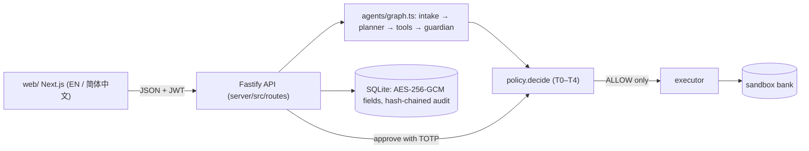

# README.md vs. official Source Code README template — gap list

Compared: `README.md` (repo root, unchanged) against `source-code-readme-template-en.md` (2026 FinTechathon, official templates of 2026-10-19).
README.md was **not modified**. The blocks under "Suggested additions" can be pasted into README.md when you decide to.

Legend: ✅ present · ⚠️ partial · ❌ missing

| Template section / field | Status in README.md | Gap |
|---|---|---|
| **1. Project Overview** – Track | ✅ "International Track · Topic C" (subtitle) | Template calls it "International AI Track"; no section with this heading |
| – Team name | ❌ | No team name anywhere (use `[TEAM NAME]` until confirmed) |
| – Project name | ✅ "Setu 桥" | — |
| – One-line summary | ✅ bold sentence in intro | Not labelled as the one-line summary |
| **2. System Architecture** – components, models, tools, data sources and their relationships | ⚠️ "How it is safe" paragraph + repository map + link to docs/ARCHITECTURE.md | Tools allowlist, models (scripted planner, optional Gemini/Groq) and data sources are not listed together in README |
| – Architecture diagram | ❌ in README (Mermaid diagrams exist only in `docs/ARCHITECTURE.md` and `docs/ARCHITECTURE_TS.md`) | Template asks for a diagram in the README |
| **3. Environment and Dependencies** – Operating system | ❌ | Not stated |
| – Runtime versions | ⚠️ "Node 20+" | npm version and web stack versions (Next.js 16.4.2, React 19, next-intl 4) not in README |
| – Main dependencies | ❌ | Not listed (Fastify, Zod, better-sqlite3 12.4.1, decimal.js, jose, @node-rs/argon2, pino, vitest) |
| – Environment variables, no real secrets | ✅ Configuration section + "dev defaults are public; replace them" | — |
| **4. Installation and Execution** – clean-environment setup, configuration, launch, access | ⚠️ `make install / demo / api / web`, URLs, Docker | No `git clone` step; no `cp .env.example .env` step; no-`make` commands only described in words ("thin wrapper over `cd server && npm run …`") |
| **5. Testing** – commands | ✅ `make test`, `make evidence`, `make lint` | — |
| – Test cases | ⚠️ suites named in the `make test` row and the evidence table | No list of test directories/cases |
| – Expected results | ❌ | Expected outcomes are not stated (e.g. `npx vitest run` → 24 files / 524 tests passed on 19 Oct 2026; 25/25 golden; 17/17 attacks; 33/33 corpus) |
| – Known limitations | ✅ "Limitations (short list)" + "Honest note" | — |
| **6. Repository and Deployment** – GitHub link | ✅ "Source:" line | Not under a Repository heading |
| – Live demo (if available) | ❌ | No hosted demo; the demo video link is also not in README (`submission/Setu_Demo.mp4`) |
| – Deployment instructions | ⚠️ native + Docker Compose | No production checklist (exists in `submission/Setu_Technical_Documentation.md` §6.5); Docker images noted as never built |
| **7. Security Notes** – permission tiers | ✅ tier table T0–T4 | — |
| – Confirmation for sensitive operations | ✅ TOTP / family approver / cooling-off described | — |
| – Data handling | ⚠️ honesty box (synthetic data) only | AES-256-GCM at rest, HMAC tokenisation, PII redaction, `DELETE /me`, offline-by-default not summarised in README |
| – Known risks | ✅ linked to `docs/SECURITY_SELF_ASSESSMENT.md` §4 + short list | — |
| Template instruction: "complete every relevant section in English" using the template headings | ⚠️ | README uses its own headings; judges looking for sections 1–7 must map them themselves |

## Suggested additions (paste-ready, English)

### A. Submission summary block (template sections 1, 6) — suggested near the top

```markdown
## FinTechathon submission summary
- **Track:** International AI Track · Topic C — Cross-border & Student Finance Assistant
- **Team name:** [TEAM NAME]
- **Project name:** Setu 桥
- **One-line summary:** Setu reads a fee notice, explains it in English or 简体中文, shows the real total cost and prepares the payment — but never moves money on a model's say-so.
- **GitHub repository:** https://github.com/Zul-Qarnain/setu-fintechathon
- **Demo video:** https://github.com/Zul-Qarnain/setu-fintechathon/blob/main/submission/Setu_Demo.mp4 (3 min 26 s)
- **Live demo:** not hosted; run locally with `make install && make demo` (offline, no keys)
```

### B. Architecture diagram (template section 2)

````markdown
## System architecture

- **Models:** deterministic scripted planner (default, offline); optional Gemini / Groq adapters behind the same allowlist (tokenised text only, untested live).
- **Tools (allowlist):** get_obligation, list_obligations_due, fx_quote, compute_costs, budget_summary, propose_payment, propose_verify_payee, draft_message — none moves money.
- **Data sources:** `data/` — SYNTHETIC personas, 33 fee notices, 12 SMS, SAMPLE FX fixture, illustrative channel costs.
- **External services:** none by default; optional live FX (open.er-api.com, `FX_MODE=live`).
````

### C. Environment and dependencies (template section 3)

```markdown
## Environment and dependencies
- **Operating system:** [STATE THE OS(ES) YOU TESTED ON — not recorded in the repo]
- **Runtime:** Node 20+ (`.nvmrc` = 20); no Python, no API keys, no network needed
- **Server:** TypeScript (strict), Fastify, Zod, better-sqlite3 12.4.1, decimal.js, jose, @node-rs/argon2, pino; tests: vitest
- **Web:** Next.js 16.4.2, React 19, next-intl 4; tests: vitest, Playwright
- **Environment variables:** copy `.env.example` to `.env`; `JWT_SECRET`, `HMAC_KEY`, `AES_KEY_B64` ship with public dev defaults and must be replaced outside a demo. Never commit real secrets.
```

### D. Clean-environment install (template section 4)

```markdown
## Installation and execution (clean environment)
git clone https://github.com/Zul-Qarnain/setu-fintechathon && cd setu-fintechathon
cp .env.example .env            # optional; defaults run offline
make install                    # or: (cd server && npm ci) && (cd web && npm install)
make api                        # or: cd server && DEMO_MODE=true npm start   → http://localhost:8000
make web                        # or: cd web && npm run dev                   → http://localhost:3000
Sign in as aisha@demo.setu.test / demo-password-123 (SYNTHETIC).
```

### E. Testing — expected results (template section 5)

```markdown
## Testing
| Command | Expected result (latest run) |
|---|---|
| `cd server && npx vitest run` (= `make test`) | 24 test files, 524 tests passed (19 Oct 2026) |
| `make evidence` → `evidence/eval_report.md` | 25/25 golden tasks passed; notice corpus 33/33 verdicts, 33/33 field parsing |
| `make evidence` → `evidence/security_report.md` | 17/17 adversarial scenarios blocked |
| `make demo` → `evidence/audit_export.json` | `verify.ok = true`; prints the audit `head_hash` |
Test suites: `server/tests/unit`, `api`, `golden`, `security`, `parity`.
```

### F. Security notes — data handling (template section 7)

```markdown
### Data handling
AES-256-GCM (with AAD) at rest for payee account numbers, TOTP secrets and notice text; HMAC-SHA256 account tokens so plaintext accounts never reach a planner; PII redacted in logs and before audit hashing; `DELETE /me` erasure; offline by default, no third-party scripts. Known risks: docs/SECURITY_SELF_ASSESSMENT.md §4.
```

### G. Deployment — production checklist (template section 6)

```markdown
### Production checklist
`NODE_ENV=production`, `DEMO_MODE=false`, fresh `JWT_SECRET` / `HMAC_KEY` / `AES_KEY_B64`, TLS at a reverse proxy, `CORS_ORIGINS` restricted to the web origin, persistent and backed-up SQLite volume, periodic publication of the audit `head_hash`.
```

## Inconsistencies noticed while comparing (for whoever edits the docs)
- `submission/Setu_Technical_Documentation.md` §7.2 and `Setu_Deck.pptx` slide 10 say **22 test files / 507 tests**; a fresh `npx vitest run` on 19 Oct 2026 gives **24 files / 524 tests**. The official-template outputs use 524.
- `docs/DATA_FLOW.md` mentions "text or text-layer PDF" uploads and "structlog"; the TypeScript backend accepts text/.txt only (PDF → 422) and logs with pino. `docs/SECURITY_SELF_ASSESSMENT.md` §3 also still says "text-layer PDFs only".
- `.env.example` sets `DEMO_MODE=true`, while the README says the code default is off (both are true; worth one clarifying sentence).
