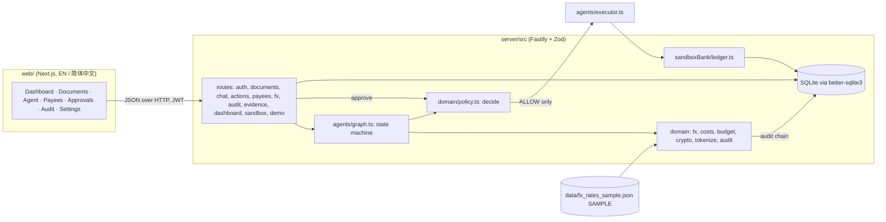
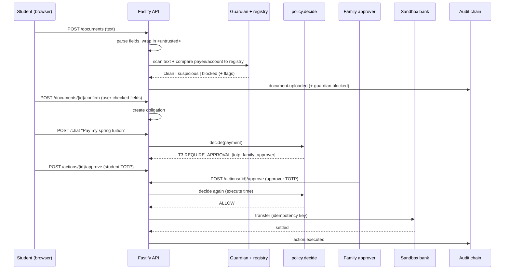

# Setu 桥 — Technical Documentation

*2026 Shenzhen FinTechathon · International Track · Topic C: Cross-border & Student Finance Assistant*

> **Data notice.** All data in this project is **SYNTHETIC** (personas, fee notices, SMS, accounts). The bank is a **SANDBOX** ledger. Setu **never holds funds**. Offline FX rates are labelled **SAMPLE** (not live) and channel fees are illustrative. The default planner is a deterministic **scripted** planner that runs fully offline.

This document consolidates `README.md`, `docs/ARCHITECTURE.md`, `docs/ARCHITECTURE_TS.md`, `docs/API.md`, `docs/DATA_FLOW.md`, `docs/THREAT_MODEL.md`, `docs/SECURITY_SELF_ASSESSMENT.md`, `docs/MOBILE_PLAN.md`, `web/CONTRACT_NOTES.md` and the generated reports in `evidence/`. Repository: `Zul-Qarnain/setu-fintechathon` (main, `cc4247d`).

---

## Contents
1. [Overview](#1-overview)
2. [Architecture](#2-architecture)
3. [Permission tiers T0–T4](#3-permission-tiers-t0t4)
4. [API overview](#4-api-overview)
5. [Security design](#5-security-design)
6. [Deployment](#6-deployment)
7. [Testing and evidence](#7-testing-and-evidence)
8. [Demo walkthrough](#8-demo-walkthrough)
9. [Next phase](#9-next-phase)
10. [Repository map](#10-repository-map)

---

## 1. Overview

International (South Asian) students in China pay tuition, dorm fees and insurance across borders, receive notices in Chinese they may not fully read, and are a prime target for "the account number changed" scams. **Setu reads the notice, explains it in English or 简体中文, shows the real total cost, and prepares the payment — but never moves money on a model's say-so.** A deterministic policy engine plus a family approver decide, and every step is written to a tamper-evident audit log.

What is built:

| Component | Technology | Location |
|---|---|---|
| Backend API | TypeScript (strict), Node 20, Fastify, Zod, better-sqlite3 (pinned 12.4.1), decimal.js, jose (JWT), @node-rs/argon2, pino | `server/` |
| Agent pipeline | Hand-written state machine (no agent framework), scripted EN/ZH planner | `server/src/agents/` |
| Policy engine | Pure function `policy.decide(action, ctx)` | `server/src/domain/policy.ts` |
| Sandbox bank | Toy ledger with idempotency keys and deterministic failure modes | `server/src/sandboxBank/` |
| Web app | Next.js, bilingual (English / 简体中文) via next-intl | `web/` |
| Evaluation kit | 25 golden tasks, 17 attack scenarios, 33-notice corpus | `server/eval/`, `server/src/evalkit/`, `data/` |
| Reference implementation | Original Python/FastAPI backend, source of differential test vectors | `legacy/backend-py/` |

---

## 2. Architecture

### 2.1 Design principles
1. **The LLM interprets; deterministic code computes.** Every number a user sees (fees, BDT needed, rates, dates) comes from deterministic code (`domain/fx.ts`, `costs.ts`, `budget.ts`). A reply validator rejects any reply containing a number that is not in a tool output or the user's own message.
2. **The server decides, never the model.** One pure function, `policy.decide(action, ctx)`, authorises every action. It is evaluated when an action is proposed, again on every approval, and a last time inside the executor. The executor accepts only `ALLOW`.
3. **Documents and SMS are DATA.** They are wrapped in `<untrusted>`, scanned by the guardian, and can never be the *source* of a payment, a payee or an amount. Payees and amounts are resolved server-side from the payee registry or a user-confirmed obligation.
4. **Default deny, smallest blast radius.** Unknown action types, unregistered/unverified payees, document-sourced actions and bulk exports are T4 (blocked).
5. **Tamper-evident accountability.** Every material event is appended to a SHA-256 hash-chained audit log with PII redacted before hashing.
6. **Works offline.** The default planner is the deterministic scripted adapter; no keys, no network and no model are needed for tests, the demo or the API.

### 2.2 Component map



### 2.3 Agent pipeline (`agents/graph.ts`)

`intake → planner → tools → guardian → policy → executor | await_approval → validator`

| Step | What it does | Trust boundary |
|---|---|---|
| intake | Reads uploaded `.txt` or pasted text, parses fields with regexes (EN + 简体中文), tokenises account numbers (`ACCT_…`), wraps the text in `<untrusted>` | document text is untrusted |
| planner | Emits **only** `ToolCall` JSON from an allowlist: `get_obligation`, `list_obligations_due`, `fx_quote`, `compute_costs`, `budget_summary`, `propose_payment`, `propose_verify_payee`, `draft_message`. Schema, tool name and per-tool arguments are validated (extra keys forbidden); invalid plans are rejected | planner output is untrusted |
| tools | Deterministic code. `propose_*` only *creates* an action row; nothing executes | server code |
| guardian | Regex rules (EN/ZH) + registry checks: injection phrases, "don't ask the user", personal-account channels, urgency scams, homoglyphs, amount mismatch, payee changed / unverified / lookalike / not in registry | rule-based |
| policy | `decide()` returns `ALLOW / REQUIRE_APPROVAL / REQUIRE_COOLING_OFF / BLOCK` plus tier T0–T4 and machine reasons | the only authority |
| executor / await_approval | `ALLOW` → sandbox bank transfer (idempotent). Otherwise the action waits for TOTP / family approver / cooling-off | accepts `ALLOW` only |
| validator | Every number in the reply must be grounded in tool outputs or the user message, otherwise a safe fallback reply is used | output check |

`POST /chat` returns a `trace` object with these seven steps, which the web app renders as a live trace (`llm_mode: scripted-offline`).

**Planner.** The `ScriptedAdapter` classifies intent with deterministic EN/ZH regexes in the order payee-change, unsafe, FX, how-much, pay, fees, budget. The planner sits behind an adapter interface, so other planners can be added later under the same allowlist and schema validation.

### 2.4 Domain modules
- `domain/crypto.ts` — AES-256-GCM with AAD (`enc:v1:` prefix, fresh random 12-byte IV per encryption) for payee accounts, TOTP secrets and uploaded text; HMAC-SHA256 for lookups.
- `domain/tokenize.ts` — NFKC normalisation, homoglyph detection, name skeletons, HMAC tokens, `redactPII` for logs and audit.
- `domain/audit.ts` — canonical JSON, hash-chain compute/verify.
- `domain/fx.ts` — FX service: fixture (labelled SAMPLE) or live adapter (open.er-api.com, `FX_MODE=live`), 24 h cache, injectable clock, live-failure fallback labelled as fixture.
- `domain/costs.ts`, `budget.ts` — fee model (sandbox "licensed partner A": USD 3.00 fixed + 0.40 % FX margin, illustrative) and budget summaries. Money uses `decimal.js`, never floats.
- `security.ts`, `deps.ts` — argon2id passwords; JWT HS256 pinned, `exp/sub/iat` required, role re-read from the DB on each request; RFC 6238 TOTP on `node:crypto` (±1 step, replay protection, 5-failure / 300 s lockout); sliding-window rate limiter.

### 2.5 Sandbox bank (deterministic behaviour)

| Trigger | Result |
|---|---|
| destination ends `0013` | `failed` / `ACCOUNT_CLOSED` |
| amount > CNY 50,000 | `failed` / `LIMIT_EXCEEDED` |
| amount with cents `.99` | `held` / `RISK_HOLD` |
| balance < amount | `failed` / `INSUFFICIENT_FUNDS` |
| same idempotency key, same parameters | returns the original transaction (no double spend) |
| same key, different parameters | rejected (idempotency mismatch) |

### 2.6 Persistence
SQLite via better-sqlite3 (in-memory for tests and the demo; a file or Docker volume for the API). Tables: `users, payees, documents, obligations, plans, actions, audit, sbx_accounts, sbx_txns`. Money is stored as TEXT and serialised as decimal strings (`"18500.00"`).

### 2.7 Data flow: fee notice → payment



---

## 3. Permission tiers T0–T4

| Tier | Action | Conditions | Authorisation required |
|---|---|---|---|
| T0 | Read: quotes, fee explanations, budget, dashboards | authenticated user, own data | none |
| T1 | Draft: messages, payment drafts | nothing is sent or executed | none |
| T2 | Payment ≤ CNY 2,000 | **verified** payee, trusted source, guardian clear, 24 h per-payee aggregate still ≤ cap, no active cooling-off | student **TOTP** |
| T3 | Payment > CNY 2,000; split payments exceeding the cap; any payment to a new/changed payee; verifying a payee | as above | student TOTP **+** linked family approver TOTP; **+ 24 h cooling-off** for new/changed payees |
| T4 | Blocked | unverified/unregistered payee; action sourced only from document, SMS or model text; guardian block (injection, homoglyph, amount mismatch, lookalike); payee of another user; amount ≠ confirmed obligation; bulk PII export; unknown action type | cannot be approved |

- Admins have read-only oversight and **cannot approve payments**. A family approver can act only for students linked to them.
- **Payee lifecycle:** create (unverified → payments are T4) → verify by linked family approver / admin → payments are T3 until `cooling_off_until` (created + 24 h) passes → then T2/T3 by amount. Seeded institutions (university, dorm, insurance, provider) are verified with no cooling-off.
- **Decision reasons** are machine codes, e.g. `WITHIN_T2_CAP`, `OVER_T2_CAP`, `PAYEE_VERIFIED`, `PAYEE_UNVERIFIED`, `NEW_PAYEE`, `PAYEE_CHANGED`, `DOC_ONLY_SOURCE`, `INJECTION_DETECTED`, `BULK_PII_EXPORT`, `SPLIT_PAYMENT_SUSPECTED`, `AMOUNT_MISMATCH`.
- **Action lifecycle:** `draft` → `awaiting_approval` → (`cooling_off` →) `approved` → `executed` | `failed`; or `rejected` / `blocked` (T4, terminal).
- Configurable via env: `T2_CAP_CNY` (default `2000`), `COOLING_OFF_HOURS` (default `24`).

---

## 4. API overview

Base URL `http://localhost:8000`. Full request/response examples: `docs/API.md`.

**Conventions**
- Auth: `Authorization: Bearer <JWT>` from `/auth/login`. Roles: `student`, `family_approver`, `admin`.
- Money: decimal **strings** (`"18500.00"`), fields suffixed `_cny`; `bdt_needed` is BDT.
- Time: ISO-8601 UTC; dates `YYYY-MM-DD`. IDs are prefixed (`usr_`, `doc_`, `obl_`, `pay_`, `plan_`, `act_`, `trc_`).
- Every response carries `x-request-id`.
- Errors: `{"error": {"code", "message", "details"}, "request_id"}`. Cross-user resource access returns `NOT_FOUND` (no existence leak).

**Endpoints (as registered in `server/src/app.ts` and `server/src/routes/`)**

| Method & path | Purpose | Notes |
|---|---|---|
| `GET /health` | Health and mode flags (`offline_mode`, `llm_provider`, `fx_mode`, `synthetic_data`) | public |
| `POST /auth/register` | Create account | argon2id |
| `POST /auth/login` | Email + password → HS256 JWT (`expires_in` 3600 s) | same error for unknown user and bad password |
| `POST /auth/totp/setup` | Start TOTP enrolment | secret encrypted at rest |
| `POST /auth/totp/verify` | Confirm TOTP enrolment | |
| `GET /me` · `DELETE /me` | Current user · erasure of own data | |
| `GET /dashboard` | Obligations, BDT needed, budget, deadlines, FX disclaimer | |
| `GET /obligations` | Confirmed obligations | owner-scoped |
| `GET /fx/quote?amount_cny=…&to=BDT` | Deterministic FX quote, labelled SAMPLE in fixture mode | `UNSUPPORTED_PAIR` (422) for unknown currencies |
| `POST /documents` | Upload fee-notice text (JSON `text` or `.txt` multipart) → parsed fields + guardian verdict | text marked `untrusted: true`; status `pending_confirmation` or `blocked` |
| `POST /documents/{id}/confirm` | Student confirms parsed fields → obligation | blocked docs cannot be confirmed; `AMOUNT_MISMATCH` (409) |
| `POST /chat` | Run the agent pipeline → `reply`, `proposed_actions[]`, `trace` | nothing executes from chat |
| `GET /actions` · `GET /actions/{id}` | List / read actions with decision, tier and approvals | |
| `POST /actions/{id}/approve` | Approve with TOTP (student or linked family approver) | policy re-run; `COOLING_OFF_ACTIVE`, `TOTP_INVALID`, `TOTP_LOCKED`, `ALREADY_APPROVED` |
| `POST /actions/{id}/reject` | Reject an action | |
| `GET /payees` · `POST /payees` | List / add payees (new payees are unverified) | account numbers masked |
| `POST /payees/{id}/verify` | Verify a payee (family approver / admin) | |
| `GET /audit?verify=true` | Audit rows + chain verification (`ok`, `broken_at_seq`) | |
| `GET /evidence/export` | Redacted audit export with `head_hash` | own data; admin: all, audit-logged |
| `GET /sandbox/account` · `GET /sandbox/transactions` | Sandbox ledger views | |
| `GET /demo/personas` · `GET /demo/notices` · `GET /demo/totp/{email}` · `POST /demo/tamper-audit?seq=N` · `POST /demo/reset` | Demo helpers | only when `DEMO_MODE=true` or valid `X-Admin-Token`; otherwise 404 |

**Error codes in use:** `UNAUTHORIZED` (401), `FORBIDDEN` (403), `NOT_FOUND` (404), `validation_error` (422), `UNSUPPORTED_DOCUMENT` (422), `UNSUPPORTED_PAIR` (422), `TOO_LARGE` (413), `TOTP_INVALID` (403), `TOTP_NOT_ENABLED` (403), `TOTP_NOT_STARTED` / `TOTP_ALREADY_ENABLED` (409), `TOTP_LOCKED` (429), `COOLING_OFF_ACTIVE` (409), `INVALID_STATE` (409), `ALREADY_APPROVED` / `ALREADY_CONFIRMED` (409), `AMOUNT_MISMATCH` (409), `EMAIL_EXISTS` (409), `POLICY_BLOCKED` (403), `RATE_LIMITED` (429).

**The `trace` object** (`POST /chat`): `steps[]` (`intake|planner|tools|guardian|policy|executor|validator`, each with `status`, `duration_ms`, `detail`), `tool_calls[]` (`{tool, args, output, ok}`), `tier`, `decision`, `reply_validated`, `audit_seqs`, `llm_mode`.

**`ActionOut`:** `{id, plan_id, type, tier, status, params, decision{outcome,tier,reasons,required,cooling_off_until,explanation}, approvals[], created_at, result}`; `type` ∈ `payment|draft_message|verify_payee|export_data|read`.

---

## 5. Security design

Method: data-flow decomposition → STRIDE per trust boundary → mapping to the OWASP Top 10 for LLM Applications (2025) and to China's PIPL / Data Security Law. Full analysis: `docs/THREAT_MODEL.md`, `docs/SECURITY_SELF_ASSESSMENT.md`.

### 5.1 Trust boundaries
1. Browser ↔ API (JWT, TOTP, rate limit).
2. Untrusted content (notice, SMS, chat text) ↔ agent (guardian, `<untrusted>`, schema-checked plans).
3. Agent ↔ policy engine ↔ executor (only `ALLOW` crosses).
4. API ↔ database (encryption, hash chain, redaction).
5. API ↔ optional third parties (live FX): off by default; public data only.

### 5.2 Controls
- **Authentication:** argon2id; JWT HS256 with algorithm pinned, `exp/sub/iat` required, role re-read from the database each request; TOTP (RFC 6238, ±1 step) with replay protection and 5-failure / 300 s lockout. Secret comparisons use `timingSafeEqual`.
- **Authorisation:** role checks; owner-scoped queries; cross-user ids return 404. Admins cannot approve payments; T3 requires a distinct, linked family approver.
- **Crypto at rest:** AES-256-GCM with AAD for payee accounts, TOTP secrets and uploaded text; keyed HMAC for lookups. The server refuses the dev default keys when `NODE_ENV=production`.
- **Untrusted documents:** size caps (413), NFKC normalisation, strict ASCII-digit account validation, confusable folding, homoglyph and lookalike-payee detection (skeleton / edit distance vs the verified registry), `<untrusted>` wrapping. Document-sourced actions are T4 regardless of the guardian verdict; payee and amount are always resolved server-side.
- **Agent safety:** allowlisted tools, strict schemas, no tool moves money, `propose_*` only creates action rows, reply validator for every number.
- **Anti-structuring:** a 24 h rolling per-payee aggregate escalates split payments past the T2 cap to T3.
- **Audit:** SHA-256 hash chain over canonical JSON, PII redacted before hashing; `GET /audit?verify=true` reports `broken_at_seq`; export includes `head_hash` (printed at seed and demo end) for external comparison.
- **Privacy:** PII-redacting structured logs (pino redaction paths + free-text masking hook for account numbers, emails, phones), `DELETE /me` erasure, no third-party scripts, offline by default.
- **Availability:** per-client-IP-and-path sliding-window rate limit (`RATE_LIMIT_PER_MINUTE`, default 120), request size caps, TOTP lockout.
- **Guardian robustness:** ReDoS tests run the guardian and intake regex functions on 100 KB adversarial strings with a 250 ms limit (`tests/security/redos.test.ts`).

### 5.3 STRIDE summary

| Category | Threat | Mitigation | Scenario |
|---|---|---|---|
| Spoofing | Stolen password used to approve | TOTP on every approval, replay protection, lockout | A05, A06 |
| Spoofing | Forged JWT (alg=none, role edit, expiry) | pinned HS256, required claims, role re-read from DB | A08 |
| Spoofing | Fake payee via SMS, lookalike name, homoglyph digits | SMS never edits registry; T3 + 24 h cooling-off; lookalike / homoglyph block | A02, A03 |
| Tampering | Edit / delete / re-link audit rows | SHA-256 chain, `broken_at_seq` | A09 |
| Tampering | Amount changed between notice and payment | confirmed fields must match parse; policy compares action vs obligation | A11 |
| Tampering / Elevation | Prompt injection in a notice | `<untrusted>`, guardian, document-sourced actions T4, server-side payee/amount | A01, A14 |
| Repudiation | "I never approved that" | every approval audit-logged with actor and kind; two-person T3 | A05, A09 |
| Info disclosure | IDOR on actions/payees/documents | owner-scoped queries, 404 for foreign ids | A07, A12 |
| Info disclosure | PII in logs / audit / DB | redaction, pre-hash redaction, AES-256-GCM, masking | A10 |
| Info disclosure | Bulk export | bulk `EXPORT_DATA` is T4; export scoped to own data | A16 |
| DoS | Flooding, credential stuffing, large uploads | rate limiter, size caps, TOTP lockout | A17, A06 |
| Elevation | Executor reached without authorisation | executor refuses anything but `ALLOW`; allowlisted tools | A13, A14 |
| Elevation | Structuring below CNY 2,000 | 24 h per-payee aggregate → T3 | A04 |
| Misinformation | Hallucinated numbers in replies | reply validator, safe fallback reply | A15 |

---

## 6. Deployment

### 6.1 Prerequisites
Node 20+ (`.nvmrc`: 20). No Python, API keys or network access are needed. Every `make` target is a thin wrapper over `cd server && npm run …`.

### 6.2 Native (reference path used to produce the evidence)
```bash
make install          # npm ci (server) + npm install (web)
make api              # backend on http://localhost:8000 with DEMO_MODE=true
make web              # Next.js UI on http://localhost:3000
```
Without `make`:
```bash
cd server && npm ci && DEMO_MODE=true npm start          # API :8000
cd web && npm install && npm run dev                     # UI :3000
```
Production build of the server: `cd server && npm run build && node dist/main.js`.

### 6.3 Docker Compose
`docker-compose.yml`, `server/Dockerfile` (multi-stage `node:20-slim`, runs `node dist/main.js`, data at `/data`) and `web/Dockerfile` (Next.js standalone on `node:20-alpine`, non-root user) are provided:
```bash
docker compose up --build        # api :8000 (healthcheck on /health), web :3000, offline, no keys
```
Compose sets `ALLOW_OFFLINE=true`, `LLM_PROVIDER=scripted`, `FX_MODE=fixture`, `DEMO_MODE=true`, `CORS_ORIGINS=http://localhost:3000` and a named volume `setu-db` for SQLite. `NEXT_PUBLIC_API_URL` is inlined into the web build (the browser calls the API directly).

### 6.4 Configuration (`.env.example`, validated by Zod in `server/src/config.ts`)

| Variable | Default | Purpose |
|---|---|---|
| `ALLOW_OFFLINE` | `true` | offline operation |
| `LLM_PROVIDER` | `scripted` | planner selection; this build runs the scripted planner |
| `FX_MODE` | `fixture` | `fixture` (labelled SAMPLE) or `live` (open.er-api.com, fixture fallback labelled) |
| `DEMO_MODE` | `false` in code (`true` in Compose / `make api`) | enables `/demo/*` helpers |
| `ADMIN_TOKEN` | unset | alternative gate for demo helpers via `X-Admin-Token` |
| `DATABASE_URL` | `sqlite:///./setu.db` | SQLite location |
| `JWT_SECRET`, `HMAC_KEY`, `AES_KEY_B64` | dev values | **replace for any non-demo deployment**; rejected when `NODE_ENV=production` |
| `CORS_ORIGINS` | `http://localhost:3000` | comma-separated allowed origins |
| `PORT` | `8000` | API port |
| `RATE_LIMIT_PER_MINUTE` | `120` | per client IP and path |
| `JWT_TTL_SECONDS` | `3600` | token lifetime |
| `T2_CAP_CNY` / `COOLING_OFF_HOURS` | `2000` / `24` | policy parameters |
| `TOTP_MAX_FAILURES` / `TOTP_LOCK_SECONDS` | `5` / `300` | lockout |

### 6.5 Production checklist
- Set `NODE_ENV=production`, `DEMO_MODE=false`, and fresh `JWT_SECRET`, `HMAC_KEY`, `AES_KEY_B64`.
- Terminate TLS and add security headers at a reverse proxy; configure client-IP forwarding for the rate limiter.
- Restrict `CORS_ORIGINS` to the deployed web origin.
- Persist SQLite on a volume and back it up; publish the audit `head_hash` periodically.

### 6.6 Demo personas (SYNTHETIC; password `demo-password-123`)

| Role | Email | Notes |
|---|---|---|
| Student | `aisha@demo.setu.test` | English UI, CNY 3,500/month, approver Mr. Rahman; spring tuition CNY 18,500 (`data/fee_notices/en_tuition_aisha.txt`) |
| Student | `rafi@demo.setu.test` | 简体中文 UI, approver Mrs. Khan |
| Student | `nusrat@demo.setu.test` | English UI, approver Mr. Hossain |
| Family approver | `father.rahman@…`, `mother.khan@…`, `uncle.hossain@demo.setu.test` | approve T3 payments for their linked student only |
| Admin | `admin@demo.setu.test` | read-only oversight; cannot approve payments |

With `DEMO_MODE=true`, `GET /demo/totp/{email}` returns the current 6-digit code so judges need no authenticator app. Replay protection means one user approves once per 30-second code window.

---

## 7. Testing and evidence

### 7.1 Commands
```bash
make lint        # eslint + tsc --noEmit
make test        # vitest: unit, Python-pinned vectors, API, golden, security, parity
make demo        # scripted end-to-end scenario on an in-memory DB -> evidence/sandbox_logs.jsonl, audit_export.json, demo_summary.json
make evidence    # tests + demo + npm run evidence -> evidence/eval_report.md, security_report.md
make contract    # live status+shape diff of TS vs legacy Python backend (both on fresh DBs)
make seed-data   # regenerate data/ deterministically
```
CI: `.github/workflows/ci-ts.yml` runs `npm ci`, lint, typecheck, tests and build on Node 20 for every change under `server/`.

### 7.2 Server test suite (`server/tests/`, 22 files)
- `unit/` — policy, policy differential vectors, agent differential vectors, audit and audit store, crypto/tokenize, FX/costs/budget, ledger, reply validator, security (JWT/TOTP).
- `api/` — `fastify.inject()` tests for auth & payees, documents, chat, actions, audit/evidence/sandbox, seed.
- `golden/` — the 25 golden tasks from `server/eval/tasks.yaml`.
- `security/` — the 17 attack scenarios and ReDoS tests.
- `parity/` — replay of the Python demo transcript.

Latest run (`npx vitest run`, 19 Oct 2026): **24 test files passed, 524 tests passed.**

### 7.3 Web tests
`web/`: `npm run lint`, `tsc --noEmit`, vitest unit tests, `next build`, and a Playwright smoke suite against the real backend (`cd web && npm run build && E2E_RESET_API=http://localhost:8000 npx playwright test --project=smoke`). EN and zh-CN screenshots in `web/screenshots/` were regenerated from the TypeScript backend.

### 7.4 Evidence (from real runs, offline, scripted planner, SAMPLE FX, SYNTHETIC data)

| File | Result |
|---|---|
| `evidence/security_report.md` | **17/17 attacks blocked** (A01–A17: injection, payee-change SMS, homoglyph, structuring, replay, TOTP brute force, IDOR, JWT tampering, audit tampering, PII leakage, amount mismatch, cross-user payee, direct executor call, malicious planner output, ungrounded numbers, bulk PII export, request flooding) |
| `evidence/eval_report.md` | **25/25 golden tasks passed** (EN + 简体中文); guardian/parser corpus **33/33** verdicts and **33/33** field parsing (33 notices, 13 attack/negative) |
| `evidence/demo_summary.json` | step-by-step demo outcomes (T3 tuition settled, injected notice T4, SMS cooling-off with `409 COOLING_OFF_ACTIVE`, T2 dorm fee, sandbox failures and idempotent replay, audit verify ok over 54 entries then `broken_at_seq` after tamper) |
| `evidence/audit_export.json` | hash-chained audit export with verification result and `head_hash` |
| `evidence/sandbox_logs.jsonl` | sandbox ledger transactions from the demo |

---

## 8. Demo walkthrough

All five moments are reproduced by `make demo` and visible in the web app.

1. **Tuition notice → T3.** Aisha uploads her notice → guardian clean (CNY 18,500.00) → confirms fields → "Pay my spring tuition" → T3 → student TOTP → Mr. Rahman's TOTP → sandbox transfer settles. Agent reply: fees CNY 95.43 (0.52 %), about BDT 319,841.40 at rate 17.2000 (SAMPLE rate, not live).
2. **Injected notice → T4.** A notice saying "ignore previous instructions … do not ask the user" is blocked (`INJECTION_PHRASE`, `NO_CONFIRMATION_DEMAND`); confirm is refused; chat returns T4 `INJECTION_DETECTED`; no transaction is created.
3. **SMS "new account details" → cooling-off.** The SMS never edits the registry; a verify-payee action is created under 24 h cooling-off; approval attempts return `COOLING_OFF_ACTIVE`; payments to the new account are `PAYEE_UNVERIFIED`.
4. **Small payment → T2.** Dorm fee CNY 1,350 to a verified payee needs only the student's TOTP.
5. **Audit tamper-evidence.** `GET /audit?verify=true` is `ok`; after `POST /demo/tamper-audit` it reports `broken_at_seq` with reason `hash mismatch`. The sandbox also shows `ACCOUNT_CLOSED`, `RISK_HOLD`, `LIMIT_EXCEEDED` and an idempotent replay with no double spend.

Screenshots: `web/screenshots/en/` and `web/screenshots/zh-CN/` (login, dashboard, agent T4 block, injected document, cooling-off, T3 plan, documents, payees, approvals for student and family, settings, audit verified and broken).

---

## 9. Next phase

**Mobile (plan in `docs/MOBILE_PLAN.md`)** — ship the existing Next.js UI and TypeScript API as an installable app without a rewrite:
1. PWA: web manifest + app-shell service worker (never caching `/auth`, `/actions`, `/audit`).
2. Capacitor wrapper pointing the WebView at the deployed HTTPS origin; `@capacitor/app` (deep links), `@capacitor/preferences` (secure token storage), `@capacitor/browser`.
3. Backend for mobile: HTTPS, `CORS_ORIGINS` including `capacitor://localhost` and `https://localhost`, production keys, `DEMO_MODE=false`.
4. Auth for real users: short-lived access + refresh tokens, biometric re-auth before TOTP/approvals, certificate pinning, root/jailbreak warning.
5. Push notifications for approvals (payloads carry no amounts or account data) after review.

**Pilot readiness** (from `docs/SECURITY_SELF_ASSESSMENT.md` §5): approver consent handshake and notifications; PIPL consent management and data-subject-request tooling; OCR with human confirmation of parsed fields; additional LLM planners behind a PIPL-compliant cross-border transfer mechanism, using the same allowlist and schema checks; KMS-managed keys with rotation; external audit anchoring (periodic `head_hash` publication); Redis-backed rate limiting; independent penetration test; integration with a real licensed payment partner.

---

## 10. Repository map
```
server/src/        Fastify app: routes/, domain/ (policy, fx, costs, budget, crypto, tokenize, audit), agents/, sandboxBank/, evalkit/ (golden + attacks)
server/tests/      unit/, api/, golden/, security/, parity/ (vitest)
server/eval/       golden tasks (tasks.yaml)
legacy/backend-py/ original Python implementation (reference + differential vectors)
data/              SYNTHETIC personas, 33 fee notices (EN/ZH/mixed, 13 attack/negative), 12 SMS, FX SAMPLE rates, channel costs
docs/              API, ARCHITECTURE, ARCHITECTURE_TS, DATA_FLOW, THREAT_MODEL, SECURITY_SELF_ASSESSMENT, GLOSSARY_EN_ZH, MOBILE_PLAN
evidence/          generated reports and logs
web/               Next.js front end (EN / 简体中文), screenshots/, Playwright + vitest tests
```
